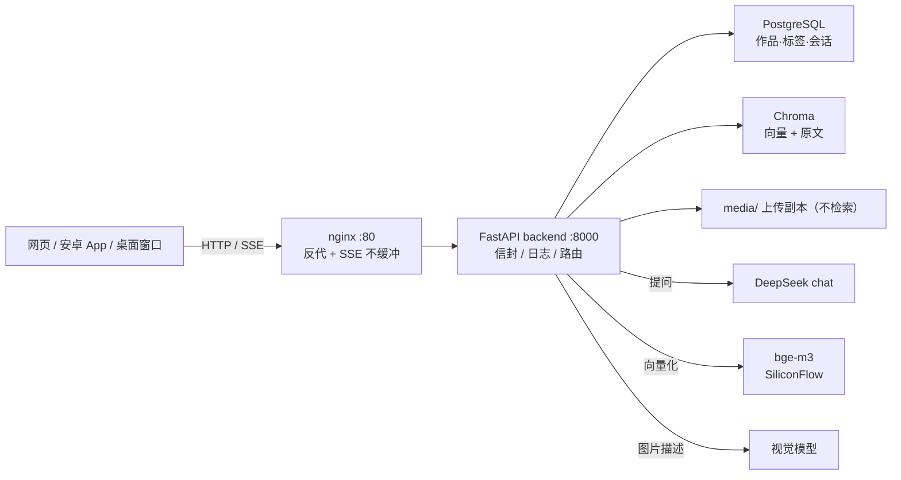

# 作品集（PortfolioHub）

[](https://github.com/Jeno-Ra/portfolio-hub/actions/workflows/ci.yml)

把散落在各处的作品（视频 / 图片 / 文本 / 代码）汇总成一个可检索、可自然语言管理的多模态作品集。

## 它解决什么问题

作品散在网盘、硬盘、微信收藏和剪辑工程里，想找「上次拍长城那组航拍有几条」只能一层层翻文件夹。
这个项目把作品**连正文/描述一起入库**，然后用自然语言问：

- 问内容 → 向量检索出相关片段，答案带 `[1]` 这样的引用，点得住、查得回；
- 问统计 → 「库里有多少条作品」直接数给你，不走模型；
- 下指令 → 「把《金山岭》改名成金山岭空镜」「删掉茶室空镜」也能在同一个输入框里做（删除要二次确认）。

三个特点：

| 特点 | 具体是什么 |
| --- | --- |
| 多模态入库 | 图片自动写画面描述、PDF/Word/PPT/Excel/代码抽正文、视频存元数据 + 可选封面描述 |
| 答案可追溯 | 每条引用都带作品名、片段序号、向量距离；没检索到就明说没有，不编 |
| 本机就能跑 | 单文件 exe 双击即用（83.5 MB），数据全在本机，不依赖云 |

## 三条上手路线

| 你的情况 | 走哪条 | 要准备什么 |
| --- | --- | --- |
| 只想自己用，不想碰命令行 | [单文件 exe](#给别人用一个-exe双击就行) | 一个 Windows，三个 API 密钥 |
| 要手机也能看（任何网络） | [容器 + Tailscale](#多设备访问手机--电脑共用一份库) | Docker Desktop、Tailscale 账号 |
| 想改代码 / 看实现 | [本地跑](#方式一本地跑sqlite--嵌入式向量库) | Python 3.12 + uv |

## 架构



一次提问实际走的路径：

```
问题 → 关键词先筛意图
      ├─ 命中「多少条 / 改成 / 删掉 / 记一条」→ 路由到统计或管理动作
      └─ 否则 → bge-m3 向量化 → Chroma top-5 → 距离 ≤ 0.45 才算命中
                ├─ 全不命中 → 代码拼拒绝话术（0 token，约 0.1 秒返回）
                └─ 命中 → 目录 + 片段喂给 deepseek-chat → 带引用回答
```

## 目录

- [它解决什么问题](#它解决什么问题) · [三条上手路线](#三条上手路线) · [架构](#架构)
- [技术栈](#技术栈) · [目录结构](#目录结构) · [接口](#接口) · [接口示例](#接口示例)
- [统一返回格式](#统一返回格式) · [日志与排查](#日志与排查)
- [怎么加作品](#怎么加作品拖进来就行) · [问答是怎么走通的](#问答是怎么走通的) · [设计说明](#设计说明三个关键决定)
- [环境变量](#环境变量) · [快速开始](#快速开始) · [多设备访问](#多设备访问手机--电脑共用一份库) · [反向代理](#反向代理80-端口)
- [大模型调用的容错](#大模型调用的容错) · [桌面客户端](#桌面客户端windows) · [Android APP](#android-appcapacitor-外壳) · [单文件 exe](#给别人用一个-exe双击就行)
- [测试](#测试) · [持续集成](#持续集成) · [性能实测汇总](#性能实测汇总) · [已知取舍](#已知取舍)

## 技术栈

| 层级        | 选型                                         |
| ----------- | -------------------------------------------- |
| 语言 / 依赖 | Python 3.12 + uv                              |
| 后端        | FastAPI + Pydantic v2                        |
| 关系库      | SQLite（开发默认）/ PostgreSQL（容器编排）    |
| ORM         | SQLAlchemy 2.x                                |
| 向量检索    | Chroma（嵌入式开发 / 独立服务编排）           |
| 前端        | 原生 HTML + CSS + JS（无框架）                |
| 接口约定    | 统一信封 `{code, message, data}` + 请求号 `X-Request-ID` |
| 可观测性    | 一行一个 JSON 的结构化日志（含耗时中间件）     |
| 质量        | pytest + Ruff + GitHub Actions                |
| 部署        | Docker 多阶段构建 + docker-compose + 自托管（局域网 / Tailscale） |

## 目录结构

| 目录             | 用途                                          |
| ---------------- | --------------------------------------------- |
| `backend/app/`   | 后端：入口组装 + 三个业务模块 + 数据层 / 检索 / 意图路由 / 权限策略（见下表） |
| `backend/tests/` | 测试用例                                      |
| `backend/media/` | 网页上传的文件副本（本地跑时的默认落点，不入库） |
| `frontend/`      | 原生单页前端                                  |
| `infra/`         | Dockerfile + nginx 反代配置                   |
| `eval/`          | 评测语料、50 条评测集与评测脚本                |
| `mobile/`        | Android 外壳（Capacitor）：`sync-web.mjs` + `android/` |
| `desktop/`       | Windows 端：Edge `--app` 启动器、图标、`portable.py` + `build.ps1`（打包成单文件 exe） |
| `scripts/`       | `deploy.ps1` 一键部署脚本                     |
| `docs/`          | 部署指南（备份恢复、故障排查）                |
| `docker-compose.yml` | 四服务编排（backend + postgres + chroma + nginx） |

`backend/app/` 的分工（按职责切，不按技术分层）：

| 模块              | 职责                                                     |
| ----------------- | -------------------------------------------------------- |
| `main.py`         | 只管组装：日志、CORS、两个中间件、`/health`、挂路由、托管前端（110 行） |
| `works_api.py`    | 作品增删改查 + 两种录入（网页上传 / 服务器路径）          |
| `qa_api.py`       | 提问：意图判断、检索、统计、改名/删除，`/ask` 与 `/ask/stream` 共用一套逻辑 |
| `settings_api.py` | 密钥读写与探活、重建索引、打包版退出                      |
| `clients.py`      | 惰性 OpenAI 客户端（三个服务共用一处，缺密钥时给出可读提示） |

## 接口

| 方法   | 路径                | 说明                                              | 成功状态码 |
| ------ | ------------------- | ------------------------------------------------- | ---------- |
| GET    | `/health`           | 健康检查（带版本号）                              | 200        |
| POST   | `/works`            | 新增作品（写入后自动建索引）                      | 201        |
| GET    | `/works`            | 作品列表，支持 `skip` / `limit` 分页              | 200        |
| GET    | `/works/{id}`       | 查询单个作品                                      | 200        |
| PATCH  | `/works/{id}`       | 更新作品（内容变了自动重建索引）                  | 200        |
| DELETE | `/works/{id}`       | 删除作品（同时清掉向量与切片）                    | 200        |
| POST   | `/works/upload`     | **网页上传**：multipart 直接传文件，后端落盘后解析（推荐） | 201 |
| POST   | `/works/ingest`     | 从服务器上的路径录入（脚本 / `docker cp` 场景）    | 201        |
| POST   | `/ask`              | 提问：意图路由 → 检索 → 大模型，返回答案与引用     | 200        |
| POST   | `/ask/stream`       | 同上，SSE 流式返回（meta → delta → done），改名/删除也走这里 | 200        |
| GET    | `/settings`         | 读密钥配置（只回显 `****后4位`）与数据目录         | 200        |
| PUT    | `/settings`         | 写密钥并热重载客户端，返回重建索引的作品数         | 200        |
| POST   | `/settings/test`    | 逐个探活三个服务（不耗生成额度）                   | 200        |
| POST   | `/quit`             | 退出桌面版（仅 exe 内可用），先回 200 再关进程      | 200        |

`/works` 返回字段：`id` / `title` / `type` / `content` / `tags` / `source_path` / `created_at`。
`tags` 传名字即可，服务端会自动建标签并在 `work_tags` 里建立关联。

### 接口示例

五个最常用的（下面都是真实调用过的命令，不是示意）：

```bash
# 1. 新增一条文本作品（写库后自动切片 + 向量化）
curl -s -X POST http://127.0.0.1:8000/works \
  -H 'Content-Type: application/json' \
  -d '{"title":"金山岭素材","type":"text","content":"清晨五点开拍，19 个镜头，其中航拍 6 个","tags":["拍摄","长城"]}'
# → {"code":0,"message":"已创建","data":{"id":1,"title":"金山岭素材",...,"created_at":"2026-11-23T12:31:07Z"}}

# 2. 传一个文件（图片会写描述、文档会抽正文）
curl -s -X POST http://127.0.0.1:8000/works/upload \
  -F "file=@长城拍摄笔记.md" -F "tags=拍摄,长城"
# → {"code":0,"message":"已上传","data":{"id":2,"title":"长城拍摄笔记",...}}

# 3. 提问（同步，一次返回完整答案）
curl -s -X POST http://127.0.0.1:8000/ask \
  -H 'Content-Type: application/json' \
  -d '{"question":"长城那组航拍用了几个镜头"}'
# → {"code":0,"message":"已回答",
#    "data":{"answer":"《金山岭素材》共 19 个镜头，其中航拍 6 个 [1]。" ,"conversation_id":7,"sources":[1]}}

# 4. 流式提问（SSE，边生成边到）
curl -N -X POST http://127.0.0.1:8000/ask/stream \
  -H 'Content-Type: application/json' \
  -d '{"question":"把《金山岭素材》的标题改成金山岭空镜"}'
# event: meta
# data: {"sources": []}
#
# event: delta
# data: {"text": "已把《金山岭素材》的标题改为「金山岭空镜」。"}
#
# event: done
# data: {"conversation_id": 8, "sources": [], "refresh": true}

# 5. 删除（第一次只预览，带 confirm 才真删）
curl -s -X POST http://127.0.0.1:8000/ask \
  -H 'Content-Type: application/json' \
  -d '{"question":"删掉金山岭空镜"}'
# → {"code":0,"message":"已回答","data":{"answer":"即将删除《金山岭空镜》（id=1），该操作不可撤销…","sources":[1]}}
curl -s -X POST http://127.0.0.1:8000/ask \
  -H 'Content-Type: application/json' \
  -d '{"question":"删掉金山岭空镜","confirm":true}'
# → {"code":0,"message":"已回答","data":{"answer":"已删除《金山岭空镜》。","sources":[]}}
```

流式事件的四个类型：`meta`（引用来源）、`delta`（增量文本，可能很多条）、`done`（会话 id + `refresh` 标记）、`error`（生成中途失败）。
`done.refresh` 为 `true` 表示这次真的改了数据，前端据此重拉列表——页面上「改名/删除」立刻生效就是靠它。

> **PowerShell 用户注意**：`curl.exe -d '{"question":"中文"}'` 经过 PowerShell 传参会丢引号，报 `JSON decode error`。
> 把 JSON 写成 UTF-8 文件再 `--data-binary "@body.json"`，或者干脆用 `Invoke-RestMethod`。

### 统一返回格式

所有 JSON 接口都套一层信封，**前端只认 `code`**，HTTP 状态码留给网关、日志和探活：

```json
// 成功：POST /works
{"code": 0, "message": "已创建", "data": {"id": 15, "title": "金山岭素材", "...": "..."}}

// 失败：GET /works/9999
{"code": 1003, "message": "作品不存在", "data": null}
```

| 业务码 | HTTP | 含义               | 什么时候出现                          |
| ------ | ---- | ------------------ | ------------------------------------- |
| 0      | 2xx  | 成功               | —                                     |
| 1001   | 400  | 调用方参数不对     | 文件类型不支持、封面不是图片、请求体有问题 |
| 1002   | 400  | 还没配置密钥       | 没填 DeepSeek / 硅基流动 / 视觉模型密钥 |
| 1003   | 404  | 找不到             | 作品 id 不存在                        |
| 1005   | 422  | 参数校验失败       | 缺字段、类型不对（`message` 会说清是哪个字段） |
| 1006   | 405  | 方法不允许         | 用错 HTTP 方法                        |
| 2001   | 502  | 上游鉴权失败       | 密钥填错                              |
| 2002   | 429  | 上游限流           | 模型服务返回 429                      |
| 2003   | 502  | 上游其他错误       | 模型服务 5xx                          |
| 3001   | 500  | 自己的 bug         | 未捕获异常（`message` 里带请求号）    |

三个刻意的例外：

- `/ask/stream` 是 SSE 事件流，套信封就没法边生成边发了；失败用 `event: error`；
- `/`、`/style.css` 这些静态文件不是 JSON；
- HTTP 状态码**没有**被信封吞掉，`curl -i`、nginx 日志、容器 HEALTHCHECK 照旧看状态码。

每个响应都带 `X-Request-ID: 9f2c1ab4`，500 的 `message` 里也会带上同一个号，
用户截个图就能和日志对上。

## 日志与排查

日志是一行一个 JSON（自己写的 `JsonFormatter`，没引日志库），`docker compose logs` 里直接能读、能 grep：

```json
{"ts":"2026-11-23T20:16:51+0800","level":"INFO","logger":"portfolio.access","msg":"request",
 "request_id":"9e47f49b","method":"POST","path":"/works","status":201,"ms":12.4}
```

- `ms` 是服务端处理耗时；**流式接口只算到「开始往外推」为止**，不是生成完成的时间；
- 静态资源（`/style.css`、`/app.js`、`/favicon.ico`）不打日志，否则一次页面加载就三行，把真正的请求埋了；
- uvicorn 自带的 access log 已关掉（它和中间件记的是同一件事，格式还不一样）；
- 容器里设了 `TZ=Asia/Shanghai`（镜像里补了 `tzdata`），`ts` 和你手机对得上。

常用几条：

```bash
docker compose logs -f backend                      # 跟着看
docker compose logs backend | grep '"status": 500'  # 只看 500
docker compose logs backend | grep 9f2c1ab4         # 按请求号定位一次调用
docker compose logs backend | tail -1 | python -m json.tool  # 单条格式化
```

## 怎么加作品：拖进来就行

网页里点「+ 新增」后，可以：

- **把文件拖到虚线框里**（一次拖多个 = 一次建多条作品），或点框选文件；
- **把文件直接拖到窗口任意位置**——弹窗会自动打开并带上这个文件；
- 有文件时「标题」可以留空（自动取文件名）、「内容」变成「备注（可选）」，
  备注会拼在解析出来的正文最前面。

解析规则：图片交给视觉模型写描述，PDF / Word / PPT / Excel / 代码 / 纯文本抽取正文，
视频只存元数据（可再传一张封面图，会补一句画面描述）。

两道校验（`backend/app/uploads.py`）：

1. **扩展名白名单**——图片 / 视频 / PDF / Word / PPT / Excel / 文本 / 常见代码。
   `.doc`、`.ppt` 这类老格式会给「请另存为 .docx」的可执行提示；`.exe` 之类直接 400，
   文件**根本不会落盘**。
2. **图片魔数**——落盘后读前 16 字节比对魔数，`.png` 其实是改名的视频会被拦下，
   并把刚写的那份副本删掉（不留垃圾）。

为什么不是「填一个本地文件路径」：浏览器出于安全拿不到 `<input type=file>` 的真实路径，
所以网页只能把**文件本体**上传上来，后端存一份副本再解析。副本落在 `media/`
（容器里是 `/app/data/media`），单个文件上限 512 MB。

删除作品时只删这份副本；`source_path` 指向你磁盘上原始位置时**绝不删除原文件**。

## 问答是怎么走通的

```
用户提问
  ├─ 关键词命中「改成/删掉/记一条/多少条」→ 意图路由（LLM 抽槽位）
  │     → create / update / delete / stats
  └─ 否则 → search
        ├─ 问题向量化（bge-m3, 1024 维）
        ├─ Chroma top-5，按距离阈值 0.45 过滤
        ├─ 没命中 → 代码拼拒绝文案，不调用模型（零 token）
        └─ 命中 → 目录 + 相关片段喂给 deepseek-chat → 带引用编号回答
```

**AI 的写权限是受限的**（`backend/app/policy.py`）：只能改标题 / 标签 / 类型，
**不能改作品内容**（内容来自原始文件，改掉等于丢数据），也从不写磁盘上的源文件；
删除必须二次确认。

上面这套判断在 `/ask` 和 `/ask/stream` 里是**同一份代码**（`qa_api._prepare`），
所以「把《金山岭》改名成 X」「删掉茶室空镜」在界面上同样能生效——流式接口不是只读检索。
管理动作没有增量文本，一次 `delta` 推完整句就结束；`done` 事件带 `refresh: true`，
前端据此重新拉一次列表，避免界面上还挂着旧标题。

## 设计说明（三个关键决定）

这三个点面试时最容易被追问，所以把「当时怎么选、为什么这么选」写清楚。

### 1. 先全量注入（v0），再换向量检索（v1）

第一版是 `/ask` 把**全部作品的正文**拼进 prompt。作品少时简单直接，但一多就崩：prompt 超长、
按 token 计费、回答变慢，而且模型会被无关内容干扰。

v1 改成「先检索、再回答」：问题向量化 → Chroma top-5 → 只把命中的片段和一份目录喂给模型。
回答里带 `[1]` 这样的编号，对应到 `sources` 里的作品 id，能点回去核对。
**没检索到就不编**——直接回一句「库里没有相关内容」，这条路径根本不调用模型（零 token）。

### 2. 阈值用绝对距离 0.45，宁可说没有

Chroma 的 cosine 距离越接近 0 越相关。0.45 不是拍脑袋定的，是拿 10 条查询量出来的：

| 类别 | 距离范围 | 均值 |
| --- | --- | --- |
| 相关 | 0.320 – 0.384 | 0.349 |
| 无关 | 0.510 – 0.654 | 0.588 |

两类之间有空隙（0.384 ~ 0.510），取中间偏保守的 0.45：**宁可拒绝，也不拿不相关的片段硬答**。
代价是同义改写（「片子」问「视频」）偶尔会被判成无关；作品量变大后这个值要重新校准，
所以它放在 `qa_api.MAX_DISTANCE` 一个常量里，改一处即可。

### 3. 重试只有一个人负责，且总预算封顶

踩过一个坑：OpenAI SDK 自己默认重试 2 次，业务层又重试 4 次，一次超时实际发出去 3 个请求、
耗时从 5 秒变成 16 秒。修法是**只留一个重试者**——SDK 侧 `max_retries=0`，重试逻辑全在 `llm.py`：

| 机制 | 行为 |
| --- | --- |
| 单次超时 | 5 秒（`LLM_TIMEOUT`） |
| 重试 | 仅超时/连接失败/限流，最多 4 次，指数退避 0.5→1→2→4 秒；认证与参数错误不重试 |
| 总预算 | 30 秒（`LLM_TOTAL_BUDGET`），超了就返回兜底文案，接口不报 500 |
| 流式 | **不重试**：已经开始输出再重试会让前端看到重复内容，失败就发一个 `error` 事件 |

结果是「最坏耗时可控」：接口永远不会挂 60 秒，用户最多等 30 秒就看到一句人话。

## 环境变量

复制模板并填入密钥：

```bash
cp .env.example .env
```

| 变量                | 必填 | 默认值                     | 说明                                    |
| ------------------- | ---- | -------------------------- | --------------------------------------- |
| `DEEPSEEK_API_KEY`  | ✅   | —                          | platform.deepseek.com                   |
| `DEEPSEEK_BASE_URL` |      | `https://api.deepseek.com` | 兼容其他 OpenAI 协议服务                |
| `DEEPSEEK_MODEL`    |      | `deepseek-chat`            | 对话模型                                |
| `LLM_TIMEOUT`       |      | `5`                        | 单次请求超时（秒）                      |
| `LLM_TOTAL_BUDGET`  |      | `30`                       | 整个重试链总预算（秒）                   |
| `EMBEDDING_API_KEY` | ✅   | —                          | 硅基流动（SiliconFlow）                 |
| `EMBEDDING_BASE_URL`|      | `https://api.siliconflow.cn/v1` | OpenAI 兼容接口                    |
| `EMBEDDING_MODEL`   |      | `BAAI/bge-m3`              | 换模型必须同步改 `EMBEDDING_DIM` 并重建向量库 |
| `EMBEDDING_DIM`     |      | `1024`                     | 维度守卫：不符会在写库前报错            |
| `GPT_API_KEY`       | ✅   | —                          | 图片描述用的视觉模型                    |
| `GPT_BASE_URL`      |      | `https://api.openai.com/v1`| 可指向任意兼容中转                      |
| `GPT_MODEL`         |      | `gpt-6.1-terra`            | 视觉模型名                              |
| `POSTGRES_PASSWORD` |      | `portfolio_dev_password`   | 仅 docker compose 使用                  |
| `MEDIA_DIR`         |      | `backend/media`            | 上传副本存放目录（容器里是 `/app/data/media`） |
| `PORTFOLIO_DATA_DIR`|      | `%LOCALAPPDATA%\作品集`    | 桌面版的全部数据（库 / 向量 / 上传副本 / 设置），设了就当绿色版 |

> `.env` 已写入 `.gitignore`，不会进入版本库；`.env.example` 只含变量名，可安全提交。

## 给别人用：一个 exe，双击就行

前面几种方式都要求对方会装 Docker、会填 `.env`、会敲命令。如果只是想把作品集交到一个
**完全不懂技术的人**手里，用这一个文件：

```powershell
.\desktop\build.ps1          # 产物：desktop\dist\作品集.exe（单文件，83.5 MB）
```

双击 `作品集.exe` 会发生什么：

1. 进程在 `127.0.0.1:8765` 起一个完整的后端（FastAPI + 前端页面 + 嵌入式向量库 + SQLite），
   不需要 Docker、不需要装 Python、不联网也能启动；
2. 用系统自带的 Edge 以 `--app` 模式开一个无地址栏窗口（没有 Edge 就退回默认浏览器）；
3. 三个密钥没填过 → 自动弹出「设置」向导，填完点保存，作品会立刻补建索引；
4. 之后就是正常用：拖文件进来、提问、看引用。右上角「设置」可以随时改密钥，还能「测试连接」；
5. 点「退出程序」= 关掉后端进程（`POST /quit`），不是只关窗口。

对方需要知道的只有三件事：**双击、填一次密钥、数据在哪**（`使用说明.txt` 里都写了）。
数据全部落在 `%LOCALAPPDATA%\作品集\`：

| 文件              | 是什么                                   |
| ----------------- | ---------------------------------------- |
| `作品集.db`       | 作品、标签、对话记录（SQLite）           |
| `向量库\`         | 嵌入式 Chroma，检索用                     |
| `作品文件\`       | 网页上传的文件副本（删作品时一起删）      |
| `设置.json`       | 三个密钥（只存本机，`masked` 回显后 4 位）|
| `运行日志.txt`    | 出问题时的报错，让人发这个文件过来即可    |

想让整包变成**绿色版**（数据跟着 exe 走，放 U 盘里）：设一个环境变量再启动——

```powershell
$env:PORTFOLIO_DATA_DIR = "D:\作品集数据"
.\作品集.exe
```

实测（同一台机器、真实密钥）：

| 项目                     | 结果                                   |
| ------------------------ | -------------------------------------- |
| 双击到页面可用           | **4.8 秒**（含建库、起服务）           |
| 保存密钥（热重载）       | 0.1 秒，三个服务 `configured` 全 true   |
| 新建一条作品（建索引）   | 0.7 秒                                  |
| 拖文件上传（multipart）  | **201**，标题自动取文件名               |
| 提问命中                 | 0.9 秒，答案带 `[1]` 引用               |
| 退出后再打开             | 作品、向量、密钥都还在                  |
| 单文件体积               | 83.5 MB（PyInstaller `--onefile`）      |

打包时踩过的坑（都写在 `desktop/build.ps1` 里了，别重犯）：

- 必须 `--paths <仓库根>`，否则 `ModuleNotFoundError: No module named 'backend'`；
- 必须 `--collect-submodules chromadb`，否则运行时报
  `ModuleNotFoundError: No module named 'chromadb.telemetry.product.posthog'`
  （chromadb 按配置字符串动态 import，静态分析看不到）；
- `--icon` / `--add-data` 一律写**绝对路径**，相对路径会被解析到 `--workpath` 下面；
- 只打包 `backend/` + `frontend/`，不打包 `mobile/`、`desktop/build/`、`desktop/dist/`。

局限（如实写）：只出 Windows 版；单机使用（别人想手机看，还是用 Tailscale 那套访问 8000）；
没有 nginx，所以不带 80 端口与反向代理。

## 快速开始

### 方式零：一条命令（推荐）

```powershell
Copy-Item .env.example .env    # 先填三个密钥
.\scripts\deploy.ps1
```

脚本会：查 Docker（没起就拉起 Docker Desktop）→ 查 `.env` 和密钥 → 起容器 →
轮询 `/health` 直到**真的**能访问 → 打印本机 / Tailscale / 局域网三种地址。

实测：容器全停时 **15.7 秒**；连 Docker Desktop 都关了也能自动拉起，**32.8 秒**。

完整说明（备份恢复、换机器、9 条故障排查）见 [docs/部署.md](docs/部署.md)。

### 方式一：本地跑（SQLite + 嵌入式向量库）

```bash
uv sync
cp .env.example .env          # 填入密钥
uv run uvicorn backend.app.main:app --reload
uv run pytest -q              # 28 项：切片 / 接口 / 检索
uv run python eval/run_eval.py  # 评测：recall@5 / 拒绝准确率
```

访问 `/docs` 看交互式接口文档。

### 方式二：容器跑（四服务）

```bash
cp .env.example .env          # 填入密钥
docker compose up -d --build  # backend + postgres + chroma + nginx
docker compose ps             # 等 backend / postgres 显示 healthy
curl http://127.0.0.1:8000/health
```

数据落在命名卷 `portfolio_appdata` / `portfolio_pgdata` / `portfolio_chromadata`。
**停服务用 `docker compose stop` 或 `down`，不要用 `down -v`**（`-v` 会连数据一起删）。

#### 实测数据（本机 4 GB / 4 核 WSL，2026-11-20）

| 场景 | 到 backend healthy |
| ---- | ------------------ |
| `docker compose restart`（只重启容器） | **6.5 秒** |
| `down` + `up`（删容器，保数据） | **11.1 秒** |
| `down -v` + `up --build`（全删重建） | **12.8 秒** |

| 指标 | 数值 |
| ---- | ---- |
| 镜像体积 | **796 MB**（单阶段写法会到 1.72 GB） |
| 四服务常驻内存 | backend 170 MB + postgres 36 MB + chroma 36 MB + nginx 6 MB ≈ **248 MB**（2026-11-23 实测，开着 nginx 与一次检索后的稳定值） |
| 数据卷 | 3 个命名卷；删 backend 容器不影响 PG 与向量 |

#### 怎么确认真的跑起来了（不只是 `docker ps` 有输出）

```bash
# 1. 三个容器健康
docker compose ps                     # backend / postgres 应显示 (healthy)

# 2. 后端连的是 PostgreSQL
docker exec portfolio-backend python -c \
  "from backend.app.database import engine; print(engine.dialect.name)"   # -> postgresql

# 3. 后端连的是 chroma 服务（不是嵌入式）
docker exec portfolio-backend python -c \
  "from backend.app import vector_store as v; print(type(v._client._server).__module__)"
# -> chromadb.api.fastapi

# 4. 表建好了
docker exec portfolio-postgres psql -U portfolio -d portfolio -c '\dt'   # 6 张表

# 5. 端到端：建一条作品再问它
curl -s -X POST http://127.0.0.1:8000/works -H 'Content-Type: application/json' \
  -d '{"title":"测试","type":"text","content":"金山岭长城清晨五点拍摄，航拍 6 个镜头"}'
curl -s -X POST http://127.0.0.1:8000/ask -H 'Content-Type: application/json' \
  -d '{"question":"长城是什么时候拍的"}'      # 回答里应带 [1] 引用
```

#### 常见问题

| 现象 | 原因 | 处理 |
| ---- | ---- | ---- |
| `docker pull` 超时 / `dial tcp registry-1.docker.io` | Docker Hub 国内不可达 | 在 Docker Desktop → Settings → Docker Engine 里加 `registry-mirrors`（实测可用：`docker.m.daocloud.io`、`docker.1panel.live`、`hub.rat.dev`） |
| 引擎无响应、`docker info` 卡几十秒 | 同时跑了太多容器，4 GB 不够 | `wsl --shutdown` 重启引擎；一次只开一个项目 |
| `PermissionError: /app/data/chroma` | 命名卷属主是 root，容器内 appuser 写不进 | 镜像里预建目录并 `chown`（已在 Dockerfile 处理） |
| `container is unhealthy`（chroma） | 官方镜像是最小化镜像，没有 curl/python，写不了探活 | 改用代码里的 heartbeat 重试（`vector_store._build_client`） |
| `syntax error at or near "PRAGMA"` | `_ensure_columns()` 是 SQLite 方言 | 只在 SQLite 下执行（已加判断） |
| `/health` 通了但容器其实在崩 | 宿主机还有别的进程占着 8000 | `Get-NetTCPConnection -LocalPort 8000` 先确认端口没被占 |

## 多设备访问（手机 + 电脑共用一份库）

后端**同源托管前端**，所以只有一个地址，不需要另起静态服务器：

```
http://<电脑地址>:8000      # 页面 + API 都在这个端口
```

### 方式一：局域网（同一 WiFi，最简单）

```bash
# 查电脑内网 IP（Windows）
ipconfig | findstr IPv4
# 手机浏览器打开
# http://192.168.x.x:8000
```

需要放行 Windows 防火墙 8000 入站。部分校园网/公司网络开了 **AP 隔离**（设备之间互不可见），这种情况用方式二。

### 方式二：Tailscale（出门/4G 也能用，推荐）

Tailscale 是一层自建虚拟组网：两台设备各装一个客户端、登录同一账号，就组成一个私有网络，
彼此用固定的 `100.x.x.x` 地址互访。**不开公网端口**，也不受校园网 AP 隔离影响。

实测本机配置：

| 设备 | Tailscale 地址 |
| ---- | -------------- |
| 电脑 `desktop-qp94kil` | `100.126.133.63` |
| 手机 `cet-al00` | `100.86.250.22` |

步骤：

```bash
# 1. 电脑端：安装并登录（Windows 版 msi）
winget install Tailscale.Tailscale   # 或从 tailscale.com/download 手动安装
tailscale up                          # 浏览器里授权登录

# 2. 手机端：装 Tailscale（应用商店/官网 APK），登录同一个账号

# 3. 电脑上查自己的地址
tailscale status
# 100.126.133.63  desktop-qp94kil  Jeno-Ra@  windows

# 4. 手机浏览器 / App 里填这个地址
# http://100.126.133.63:8000
```

验证是不是真的通了（在电脑上跑）：

```bash
tailscale ping 100.86.250.22
# 前两次可能显示 via DERP(sfo) —— 走中继，慢
# 第 3 次变成 via 183.9.225.214:36418 —— 打洞成功，P2P 直连
```

实测延迟（`curl -N POST /ask/stream`）：

| 路径 | 首字节 | 总耗时 |
| ---- | ------ | ------ |
| 本机 localhost | 115 ms | 133 ms |
| 经 Tailscale 直连 | 292 ms | 320 ms |

隧道额外开销约 180 ms，流式输出不受影响（`meta → delta → done` 照常逐字到达）。

超过 3 台设备/团队用要付费，个人设备（手机+电脑）免费额度足够。

### 注意

服务跑在电脑上，所以**电脑关机会连不上**。常见做法：

- 需要时开机（最简单）
- 插电时把电源计划设为不休眠，Docker Desktop 设成开机自启
- 想 7×24 在线的话，把服务放到常开设备（旧手机/迷你主机/NAS）

## 反向代理（80 端口）

`docker compose up -d` 会多起一个 `nginx` 容器，把 `80` 接到 `backend:8000`，
于是手机浏览器里只需要 `http://100.x.x.x/`，不用记端口号。

配置在 `infra/nginx/default.conf`，四个关键点：

| 配置 | 为什么 |
| ---- | ------ |
| `client_max_body_size 512m` | nginx 默认只放行 **1 MB**，拖一个几 MB 的视频就会 413。这里和后端 `uploads.MAX_BYTES` 对齐 |
| `proxy_buffering off` | 开着缓冲时 SSE 会被攒够一个 buffer 才发，流式回答就变成"憋几秒整段蹦出来" |
| `resolver 127.0.0.11` + `proxy_pass $backend_upstream` | 写死 `http://backend:8000` 会在 nginx 启动瞬间解析 DNS，后端没起就直接启动失败；用变量把解析推迟到每次请求 |
| `proxy_read_timeout 300s` | 一次问答最长可能到 30 秒（LLM 总预算），默认 60 秒够但留足余量 |

实测（经 80 端口）：

| 项 | 结果 |
| --- | --- |
| `GET /health` | 200 |
| `GET /` | 200，7.8 KB（同源托管的前端） |
| 流式问答 | 首字节 **0.181 s** / 总 1.165 s，30 个 delta（缓冲确实是关的） |
| 上传 2 MB 文本 | 201（默认配置下这里会 413） |
| `http://100.126.133.63/`（Tailscale 地址） | 200，7.8 KB |

> ⚠️ RAGFlow 那套也占 80 端口，两者不能同时开。要用 RAGFlow 时先 `docker compose -p ragflow stop`。

## 大模型调用的容错

`/ask` 背后由 `backend/app/llm.py` 统一封装，三层保护：

| 机制 | 行为                                                                                       |
| ---- | ------------------------------------------------------------------------------------------ |
| 超时 | 单次请求 `LLM_TIMEOUT`（默认 5 秒），超时视为本次失败                                       |
| 重试 | 仅对超时 / 连接失败 / 限流重试，最多 4 次，指数退避（0.5→1→2→4 秒）；认证与参数错误不重试   |
| 降级 | 超出预算或重试耗尽时返回兜底文案，接口不返回 500                                            |

`LLM_TOTAL_BUDGET` 保证单次 `/ask` 最坏耗时可控（默认 30 秒）。

流式端点 `/ask/stream` **不重试**：流一旦开始输出，重试会让前端看到重复内容，
所以失败时发一个 `error` 事件，让前端把气泡替换成明确的错误提示。

## 桌面客户端（Windows）

不想每次开浏览器敲网址，就在桌面放一个「作品集」图标：双击 → 独立窗口打开，没有地址栏、没有标签页。

### 安装一次

```powershell
powershell -ExecutionPolicy Bypass -File desktop\install-shortcut.ps1
```

会在**桌面**和**开始菜单**各建一个快捷方式（换电脑或重装系统后重跑一次）。

### 双击之后发生了什么

`desktop/启动作品集.ps1` 做三件事：

1. 请求 `http://127.0.0.1:8000/health`
2. 没起来就拉起 Docker Desktop → `docker compose up -d` → 轮询到健康（期间显示一个居中的等待小窗）
3. 用 Edge 的 `--app` 模式开窗：`msedge.exe --app=http://127.0.0.1:8000/ --window-size=1320,880`

实测冷启动（容器全停 → 双击 → 页面可用）：**14.8 秒**，其中 Docker 引擎本来就在跑的话只花容器启动那几秒。

### 为什么不用 Electron / Tauri

| 方案 | 体积 | 成本 |
| ---- | ---- | ---- |
| Edge `--app` | 0（系统自带 Edge） | 一个 40 行脚本 |
| Electron | +150 MB 运行时 | 要维护 package.json、打包、签名 |
| Tauri | +几 MB（用系统 WebView2） | 要装 Rust 工具链，编译链更长 |

三者显示出来的都是同一个网页，区别只在“谁来渲染”和“要不要分发安装包”。
自己一个人用、机器上本来就有 Edge，`--app` 是性价比最高的；真要做成能发给别人的 `.exe` 安装包，再上 Tauri。

### 图标

`desktop/app.ico` 由脚本生成（蓝色圆角方块 + 白色「作」，和前端主题色一致）：

```bash
python desktop/make_icon.py     # 需要 Pillow，输出 16/32/48/64/128/256 六个尺寸
```

### 局限

- 用的是 Edge 的内核，所以 Edge 被卸载/改名就没法用（Windows 10/11 默认自带）
- 窗口里没有浏览器菜单，前进后退快捷键仍然可用；要 DevTools 用 `F12`
- 服务仍需电脑开着：手机端（APK/浏览器）通过 Tailscale 连的也是这台机器

## Android APP（Capacitor 外壳）

`mobile/` 用 Capacitor 把页面装进安卓 App。**它不是独立后端**：数据仍然连你电脑上的服务。

> **界面是远程加载的**：`capacitor.config.json` 里配了 `server.url`，App 启动时直接从后端拉页面。
> 所以改前端（界面、交互）**不用重新装 APK**——电脑上 `docker compose up -d --build` 重建一次，
> 手机退到桌面再打开，就是新界面。只有改原生层（包名、图标、权限、App 名字）才需要重编重装。

### 编译

```bash
cd mobile
npm install            # 首次
npm run build:apk      # 一条命令：生成 www/ 兜底页 → cap sync → gradle 编译
# 产物：app/build/outputs/apk/debug/app-debug.apk
```

### 前置环境

| 需要 | 版本 | 说明 |
| ---- | ---- | ---- |
| JDK | **21** | Capacitor 8 要求；JDK 17 会报「无效的源发行版: 21」 |
| Android SDK | platform 35+ / build-tools 35+ | `sdkmanager` 安装 |
| Gradle | 8.x（wrapper 自带） | 国内换镜像 `mirrors.cloud.tencent.com/gradle/` |

本机实际配置：

```
JAVA_HOME        F:\Android\jdk21\jdk-21.0.13+9
ANDROID_HOME     F:\Android\sdk
GRADLE_USER_HOME F:\Android\gradle
```

### 后端地址与「不用重装」模式

地址只写在 `mobile/capacitor.config.json` 的 `server.url`（默认 `http://100.126.133.63:8000`，本机的 Tailscale 地址）：

```json
"server": {
  "url": "http://100.126.133.63:8000",
  "cleartext": true,
  "errorPath": "error.html"
}
```

- 想换地址（比如改用局域网）只改这一行，再 `npm run build:apk` 一次；
- `errorPath` 指向 `www/error.html` 兜底页：连不上时会告诉你检查 Tailscale / Docker，而不是白屏；
- 远程加载的副作用是**必须先连上后端**才能看到界面（这本来也是唯一的用法），
  真要离线看，把 `server` 整段删掉重编即可退回「界面打包进 APK」的老模式。

APK 需要允许明文 HTTP（`android:usesCleartextTraffic="true"`，已配），否则 Android 9+ 会拦掉 `http://` 请求。

### App 名字与图标文字

显示名不在 `capacitor.config.json` 里生效，而是 Android 资源：

```
mobile/android/app/src/main/res/values/strings.xml
  <string name="app_name">作品集</string>
  <string name="title_activity_main">作品集</string>
```

改完必须重新 `npm run build:apk`（`cap sync` 不会改这个文件）。
界面里的标题在 `frontend/index.html`（`<title>` 与 `.topbar__title`），两处都改了才是统一的名字。

### 安装到手机

1. 把 `mobile/dist/作品集-手机安装.apk`（桌面上的同名文件）传到手机（数据线 / 微信文件传输）
2. 点击安装，允许「未知来源」；装了旧版会提示覆盖
3. 手机开着 Tailscale、电脑上 `docker compose up -d` 在跑，就能用——**不需要同一个 WiFi**

打开后是全屏界面（无浏览器地址栏），功能与网页版一致。
**装完这一版之后，日常改界面（按钮、排版、新功能）都不再需要重装 APK。**

## 测试

```powershell
uv run pytest        # 28 个用例，实测 3.1 秒
uv run ruff check .  # 静态检查
```

两条硬规则决定了测试怎么写：

| 规则         | 做法                                                                                        | 为什么                                         |
| ------------ | ------------------------------------------------------------------------------------------- | ---------------------------------------------- |
| 不联网       | `backend/tests/fakes.py` 把 embedding / 对话 / 意图解析 / 向量库全换成假实现                 | 真调一次要花钱、CI 上会超时，还测不稳           |
| 不碰真实数据 | `conftest.py` 在导入应用之前把 `DB_PATH` / `MEDIA_DIR` / `CHROMA_DIR` 指到临时目录，每个用例重建表 | 测试绝不能写进你自己的作品库                   |

**不需要 `.env`**：三个 API key 在测试里用占位值，所以新克隆的仓库（或 CI）直接 `uv run pytest` 就能跑。

`test_runs_on_temporary_database` 是保护性断言：万一环境变量没生效，它会先失败报警，而不是让后面的用例把真库清空。

覆盖范围：

| 文件          | 覆盖                                                                                                  |
| ------------- | ----------------------------------------------------------------------------------------------------- |
| `test_chunking.py` | 切片长度、重叠、边界不被切断、超长无标点不死循环、拼回原文逐字相等、句末切点（8 条）          |
| `test_api.py`      | 统一返回格式（成功信封、404/422 错误码、`X-Request-ID`）、作品增删改查、AI 只能改标题不能改内容、删除二次确认、上传落盘/入库/删副本清理、扩展名白名单、图片魔数校验且不留残档、未命中不调模型、缺密钥回 1002、流式事件顺序 `meta → delta×N → done`（15 条） |
| `test_retrieval.py` | 距离阈值过滤（0.45 闭区间）、top-k 与问题向量传参、命中全被过滤时回退拒绝、同一作品多片段去重、引用编号与 sources 同序、上下文含目录+片段（6 条） |

## 持续集成

`.github/workflows/ci.yml`——push 到 `main`、提交 PR、手动触发都会跑，两个 job 并行：

| job | 做什么 | 实测耗时 |
| --- | ------ | -------- |
| Ruff | `uv run ruff check .` | 9 s |
| Pytest | `uv run pytest -q`（28 条） | 15 s |

整个 run **18 秒**（并行执行），徽章在标题下方。

三个刻意的选择：

- **`uv sync --frozen`**：严格按 `uv.lock` 装依赖，锁文件和 `pyproject.toml` 不一致就直接失败。否则会出现「本地能跑、CI 装了另一个版本」这种最难查的问题。
- **`setup-uv` 开缓存**：缓存 `~/.cache/uv`，依赖不变时直接复用。实测两次 run 分别是 18 秒和 21 秒——这个项目依赖量小，缓存收益看不出来；依赖多的项目上差别会是几十秒。
- **CI 里没有任何 secrets**：测试全程不联网（embedding / LLM / 向量库都是假实现），所以不需要配 `DEEPSEEK_API_KEY` 之类的东西，也不会把密钥写进仓库。

## 性能实测汇总

测量环境：Windows 11 / 16 GB 内存 / WSL 限额 4 GB 4 核 / 2026-11-20 ~ 11-23。
**库内只有 1–3 条测试作品，不是真实作品量**——检索耗时随作品数和文档体量变化，这几列只代表「链路是通的、量级是多少」。

| 场景 | 数值 |
| --- | --- |
| exe 双击 → 页面可用 | **4.8 秒**（冷启动，含建库） |
| exe 已在跑，再双击 | 1 秒（只开窗口，不起第二个服务） |
| `deploy.ps1`（容器全停） | **15.7 秒** |
| `deploy.ps1`（Docker Desktop 也关着） | 32.8 秒 |
| `restart` / `down`+`up` / `down -v`+`up --build` | 6.5 / 11.1 / 12.8 秒 |
| 流式问答，命中（本机） | 首字 **594 ms**，总 819 ms |
| 流式问答，没命中（拒绝路径） | 首字 **112 ms**，总 141 ms，**0 token** |
| 流式问答，经 Tailscale 直连 | 首字节 292 ms，总 320 ms |
| 流式问答，经 nginx :80 | 首字节 181 ms，总 1165 ms，30 个 delta |
| 同步 `/ask`（命中） | 0.85 秒 |
| 检索本身（10 条查询） | 均值 159 ms，p95 219 ms |
| 统计类问句 | 0.74 ~ 1.03 秒 |
| 新增一条文本作品（含建索引） | 0.52 ~ 0.7 秒 |
| 从服务器路径录入 txt | 0.22 秒 |
| 上传 md（multipart + 解析） | 0.54 秒 |
| 上传图片（含视觉模型写描述） | 4.09 秒 |
| 镜像体积 | **796 MB**（单阶段写法 1.72 GB） |
| 四服务常驻内存 | **248 MB** |
| exe 体积 | **83.5 MB** |
| 单次问答最坏耗时 | 30 秒（`LLM_TOTAL_BUDGET` 封顶） |

工程质量：

| 项 | 数值 |
| --- | --- |
| pytest | **28 条，3.1 秒**（全程不联网、不碰真实库） |
| GitHub Actions | **18 ~ 21 秒**（Ruff 与 Pytest 并行） |
| `ruff check .` | 0 违规 |
| 后端 / 前端 / 测试代码量 | 2014 / 1302 / 421 行 |

## 已知取舍

| 取舍 | 原因 |
| ---- | ---- |
| 视频只存元数据，不做内容级检索 | 抽帧 + 语音转写要额外 40 小时，总预算只有 160 小时 |
| 切片 500 字 + 50 字重叠 | 重叠是为了避免语义被切断在边界 |
| 距离阈值 0.45 是实测校准值 | 相关 0.320–0.384，无关 0.510–0.654；作品量变大后需重新校准 |
| 「刚才那个」指代用进程内变量 | 单用户原型够用；多用户要改成按会话存储 |
| App 界面远程加载 | 换来「改前端不用重装 APK」；代价是没连上后端时只有兜底页 |
| 统一返回格式用业务码 `code`，不靠 HTTP 状态码分支 | 前端一处判断、错误话术由后端给；代价是 `curl` 时要多看一眼 `data`（`/ask/stream` 除外） |
| 日志自己写 `JsonFormatter`，不引 structlog | 只有「请求行」「应用行」两种，几十行就够；打包成 exe 时少一个装不上的可能 |
| 业务码按 1xxx / 2xxx / 3xxx 分段 | 1xxx 是调用方问题、2xxx 是上游模型、3xxx 是自己的 bug，日志里扫一眼就知道该改哪边 |
